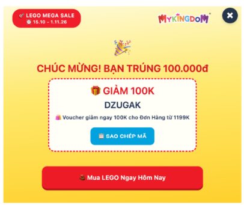

# Phân tích ba website tương tự – WONDERLAB

## 3. Phân tích các website tương tự

### 3.1. MyKingdom – Website bán lẻ đồ chơi

Website: https://www.mykingdom.com.vn/

#### Điểm mạnh

Một trong những điểm nổi bật của MyKingdom là cách website tạo sự chú ý ngay từ lần truy cập đầu tiên. Thay vì chỉ hiển thị mã giảm giá theo cách thông thường, MyKingdom sử dụng vòng quay may mắn để khách hàng có cơ hội nhận voucher. Hình thức này đưa yếu tố gamification vào hoạt động khuyến mãi, khiến trải nghiệm nhận ưu đãi trở nên thú vị và có tính tương tác hơn. Đồng thời, việc khách hàng nhận được voucher cũng có thể tạo thêm động lực để họ tiếp tục khám phá sản phẩm và thực hiện mua hàng.

Vòng quay may mắn nhận voucher trên MyKingdom

Nguồn: MyKingdom

Bên cạnh đó, MyKingdom có bộ nhận diện thương hiệu khá nhất quán và phù hợp với ngành hàng đồ chơi. Hai màu đỏ và vàng được sử dụng nổi bật, kết hợp với hình ảnh sản phẩm sinh động, tạo cảm giác vui tươi và năng động. Các biểu tượng trên website cũng được thiết kế đồng bộ với phong cách thương hiệu. Đặc biệt, việc sử dụng mascot trong nút điều hướng slider là một chi tiết nhỏ nhưng đáng chú ý, giúp giao diện có nét riêng thay vì chỉ sử dụng những biểu tượng mũi tên thông thường.

Hình 3.2. Bộ nhận diện thương hiệu và giao diện trang chủ MyKingdom

Nguồn: MyKingdom

Về cấu trúc website, MyKingdom xây dựng hệ thống điều hướng khá đầy đủ với các mục như LEGO, Hàng mới, Sản phẩm, Khuyến mãi, Thương hiệu và Outlet. Trang chủ được chia thành nhiều khu vực, bao gồm các chương trình khuyến mãi, danh mục nổi bật, sản phẩm bán chạy, nhân vật yêu thích, nhóm tuổi và thương hiệu. Cách tổ chức này giúp khách hàng có nhiều hướng để tiếp cận sản phẩm, đồng thời hỗ trợ doanh nghiệp quảng bá những mặt hàng hoặc chương trình bán hàng đang được ưu tiên.

Một điểm mạnh khác là MyKingdom kết hợp tương đối tốt giữa nội dung thương mại và nội dung tư vấn. Ngoài các khu vực trưng bày sản phẩm, website còn có mục Cẩm nang với những bài viết hướng dẫn lựa chọn đồ chơi và gợi ý quà tặng. Điều này giúp website không chỉ đóng vai trò là kênh bán hàng mà còn cung cấp thêm thông tin cho khách hàng trong quá trình cân nhắc mua sắm.

#### Điểm yếu và cơ hội cải thiện

Mặc dù có hệ thống danh mục phong phú, MyKingdom vẫn tạo ra một số cơ hội cải thiện trong hành trình tìm kiếm sản phẩm. Trang chủ dành nhiều không gian cho các chương trình giảm giá, sản phẩm nổi bật và thương hiệu. Cách tiếp cận này phù hợp với khách hàng đã có nhu cầu mua sắm tương đối rõ ràng, nhưng có thể khiến những người chưa biết nên mua đồ chơi nào phải dành thêm thời gian khám phá các danh mục khác nhau.

Đáng chú ý, MyKingdom đã có khu vực khám phá sản phẩm theo độ tuổi. Tuy nhiên, việc lựa chọn đồ chơi theo độ tuổi, sở thích, mục đích sử dụng và ngân sách chưa được thể hiện thành một quy trình tư vấn thống nhất trong những nội dung đã khảo sát. Chẳng hạn, một phụ huynh muốn tìm đồ chơi cho trẻ 7 tuổi, yêu thích khoa học và có ngân sách dưới 500.000 đồng vẫn có thể phải kết hợp nhiều thao tác tìm kiếm và lọc sản phẩm.

Ngoài ra, hình thức hỗ trợ khách hàng thông qua nhân viên có thể phát sinh thời gian chờ khi lượng yêu cầu tăng cao hoặc ngoài giờ làm việc. Việc tích hợp chatbot tự động để trả lời những câu hỏi thường gặp, hỗ trợ tìm sản phẩm và hướng dẫn mua hàng có thể giúp cải thiện trải nghiệm này.

Chatbot hỗ trợ qua nhân viên tư vấn của MyKingdom

Một hạn chế khác nằm ở mật độ thông tin trên trang chủ. Việc xuất hiện nhiều banner, chương trình khuyến mãi và khu vực sản phẩm có thể khiến sự chú ý của khách hàng bị phân tán, đặc biệt trên thiết bị di động. Vì vậy, nhóm có thể nghiên cứu cách tinh giản bố cục và ưu tiên những nội dung phục vụ trực tiếp cho nhu cầu lựa chọn đồ chơi.

### 3.2. LEGO – Official LEGO Shop

Website: https://www.lego.com/en-us/

#### Điểm mạnh

LEGO nổi bật với cách xây dựng trải nghiệm mua sắm gắn liền với hình ảnh và câu chuyện thương hiệu. Website sử dụng màu sắc sinh động, hình ảnh chất lượng cao và các banner được thiết kế riêng cho từng bộ sưu tập. Đặc biệt, việc kết hợp video và hình ảnh trực quan trên trang chủ giúp giới thiệu sản phẩm theo hướng giàu cảm xúc hơn, thay vì chỉ tập trung vào giá bán và thông số kỹ thuật. Nhờ đó, website có thể khơi gợi sự tò mò và mong muốn khám phá của khách hàng.

Hình Giao diện trang chủ Website LEGO

Nguồn: LEGO

Một điểm mạnh đáng học hỏi là cách LEGO tổ chức hành trình tìm kiếm sản phẩm theo nhiều tiêu chí khác nhau. Khách hàng có thể khám phá đồ chơi theo độ tuổi, mức giá, sở thích, chủ đề hoặc dịp tặng quà. Đặc biệt, tính năng Gift Finder hỗ trợ người mua lựa chọn sản phẩm dựa trên nhu cầu tặng quà, thay vì yêu cầu họ phải biết trước tên hoặc dòng sản phẩm. Chương trình LEGO Insiders cung cấp những quyền lợi như tích điểm, quà tặng và ưu đãi dành cho thành viên. Điều này không chỉ khuyến khích khách hàng quay lại mua sắm mà còn giúp thương hiệu duy trì mối quan hệ với người tiêu dùng sau giao dịch đầu tiên.

Trong trang giới thiệu một số bộ LEGO, website cũng lồng ghép các video ngắn nhằm minh họa cách sản phẩm được lắp ráp, sử dụng hoặc những câu chuyện gắn liền với bộ đồ chơi. Đặc biệt, với sản phẩm LEGO Ideas Home Alone, website sử dụng mô hình ngôi nhà 3D có tính tương tác. Khi khách hàng lựa chọn từng khu vực trong ngôi nhà, một đoạn video ngắn tương ứng sẽ xuất hiện, tái hiện những tình huống quen thuộc trong bộ phim. Thiết kế này không chỉ giúp người mua khám phá các chi tiết bên trong sản phẩm mà còn tạo ra trải nghiệm giải trí ngay trong quá trình tìm hiểu. Nhờ đó, trang chi tiết sản phẩm không đơn thuần cung cấp thông tin mà còn trở thành một không gian khám phá, góp phần tăng sự hứng thú và khả năng ghi nhớ sản phẩm.

Trải nghiệm mô tả sản phẩm trực quan và có tính tương tác cao

Nguồn: LEGO

#### Điểm yếu và cơ hội cải thiện

Một vấn đề cần xem xét là sự phù hợp với thị trường mục tiêu. Phiên bản LEGO tại Mỹ sử dụng tiếng Anh, USD và các chương trình mua sắm dành cho thị trường này. Vì vậy, nhóm có thể phát triển một trải nghiệm phù hợp hơn với khách hàng Việt Nam, sử dụng tiếng Việt, ngân sách bằng VNĐ và các tiêu chí lựa chọn gần gũi với nhu cầu của phụ huynh trong nước.

Bên cạnh đó, hệ thống khám phá sản phẩm của LEGO có nhiều lựa chọn về độ tuổi, sở thích, chủ đề và giá. Tuy nhiên, đối với những khách hàng chưa có định hướng cụ thể, việc lựa chọn giữa nhiều danh mục vẫn có thể đòi hỏi một số thao tác. WONDERLAB có thể học hỏi Gift Finder nhưng phát triển một quy trình tư vấn ngắn gọn hơn, trong đó khách hàng chỉ cần trả lời một số câu hỏi để nhận được danh sách sản phẩm phù hợp kèm lý do đề xuất.

Ngoài ra, trang chủ LEGO đầu tư nhiều vào hình ảnh, video và các nội dung quảng bá. Đây là điểm mạnh về mặt trải nghiệm thương hiệu, nhưng cũng đặt ra yêu cầu về tốc độ tải trang và khả năng tối ưu trên thiết bị di động.

Đối với WONDERLAB, nhóm có thể học hỏi cách tiếp cận này bằng việc tích hợp video ngắn vào trang chi tiết của một số sản phẩm nổi bật. Nội dung video có thể hướng dẫn cách chơi, cách lắp ráp, giới thiệu những kiến thức trẻ có thể học được hoặc xây dựng các tình huống vui nhộn nhằm thu hút sự chú ý của khách hàng.

Với những sản phẩm có nhiều bộ phận hoặc nhiều cách sử dụng, nhóm cũng có thể phát triển tính năng tương tác đơn giản, cho phép người dùng nhấn vào từng bộ phận hoặc bước thực hiện để xem video minh họa tương ứng. Điều này giúp phụ huynh hiểu rõ hơn giá trị của sản phẩm trước khi mua, đồng thời tạo sự khác biệt cho trải nghiệm mua sắm tại WONDERLAB ở thị trường Việt Nam.

### 3.3. OhStem / OpenSTEM – Website thiết bị giáo dục STEM

Website: https://nexy.ohstem.vn/

#### Điểm mạnh

Điểm nổi bật nhất của OpenSTEM là định vị rõ ràng trong lĩnh vực giáo dục STEM, đặc biệt ở các nội dung liên quan đến lập trình, robotics và công nghệ. Khác với các website bán đồ chơi tổng hợp, OpenSTEM hướng đến việc cung cấp giải pháp học tập, kết hợp giữa thiết bị, khóa học và các hoạt động thực hành. Cách tiếp cận này giúp website xây dựng hình ảnh chuyên môn và tạo sự khác biệt trong thị trường sản phẩm giáo dục.

Về cấu trúc, trang chủ OpenSTEM được tổ chức theo các nhóm nội dung như khóa học, đào tạo giáo viên, thử thách, thiết bị STEM và bảng giá. Bên cạnh việc giới thiệu sản phẩm, website còn trình bày các lợi ích dành cho học sinh, giáo viên và nhà trường, cũng như những lộ trình học tập liên quan đến lập trình, robotics và AI/IoT. Điều này giúp người truy cập hiểu được phạm vi giải pháp mà doanh nghiệp cung cấp, thay vì chỉ nhìn thấy những sản phẩm riêng lẻ.

Một điểm tích cực khác là cửa hàng thiết bị STEM có phân loại sản phẩm theo các nhóm như bộ kit STEM, robot, mạch lập trình, module cảm biến và phụ kiện. Một số nội dung cũng đề cập đến độ tuổi và chủ đề học tập phù hợp. Đây là cơ sở hữu ích để WONDERLAB tham khảo khi xây dựng hệ thống thuộc tính sản phẩm, đặc biệt đối với những mặt hàng có yêu cầu về độ tuổi, trình độ hoặc kiến thức sử dụng.

Giao diện trang thiết bị STEM

#### Điểm yếu và cơ hội cải thiện

Một hạn chế đáng chú ý từ quá trình khảo sát là thông tin mô tả ở một số sản phẩm chưa thực sự chi tiết hoặc có nội dung tương tự nhau. Điều này có thể khiến khách hàng khó nhận biết sự khác biệt giữa các bộ kit, đặc biệt khi các sản phẩm có tên gọi hoặc thông số gần giống nhau. Nếu mô tả chưa làm rõ sản phẩm dùng để thực hiện hoạt động gì, phù hợp với trình độ nào và cần chuẩn bị những gì, khách hàng sẽ phải tự tìm hiểu thêm trước khi quyết định mua.

Mô tả sản phẩm chưa cụ thể

Mặc dù OpenSTEM có hệ thống khóa học và nội dung giáo dục, mối liên kết giữa từng sản phẩm với mục tiêu học tập cụ thể chưa phải lúc nào cũng được thể hiện rõ trong phần giới thiệu sản phẩm. Chẳng hạn, phụ huynh có thể muốn biết một bộ kit phù hợp với trẻ mới bắt đầu hay đã có kiến thức lập trình, trẻ có thể thực hiện những dự án nào và có cần người lớn hỗ trợ hay không.

Bên cạnh đó, website sử dụng nhiều thuật ngữ chuyên môn như Robotics, AI/IoT, module cảm biến hoặc mạch lập trình. Đây là những thuật ngữ cần thiết đối với khách hàng có kiến thức kỹ thuật, nhưng có thể gây khó khăn cho phụ huynh hoặc người mua quà chưa quen với lĩnh vực STEM. Vì vậy, việc diễn giải thông tin bằng ngôn ngữ đơn giản, kết hợp ví dụ thực tế và hình ảnh minh họa sẽ giúp khách hàng hiểu rõ hơn giá trị của sản phẩm.

Cuối cùng, mặc dù website có phân loại theo độ tuổi và chủ đề, chưa thấy một quy trình tư vấn tương tác nổi bật giúp khách hàng lựa chọn sản phẩm theo đồng thời nhiều tiêu chí như trình độ, sở thích và ngân sách trong những nội dung đã khảo sát. Đây là cơ hội để WONDERLAB phát triển Wonder Finder, hỗ trợ người mua lựa chọn sản phẩm mà không cần có sẵn kiến thức chuyên môn về STEM.

## 4. Bảng so sánh và định hướng áp dụng cho WONDERLAB

| Tiêu chí | MyKingdom | LEGO Official Shop | OpenSTEM | WONDERLAB dự kiến |
| --- | --- | --- | --- | --- |
| Trang chủ | Banner khuyến mãi, sản phẩm/danh mục nổi bật | Kể chuyện bằng hình ảnh/video | Nội dung STEM, học tập và thiết bị | Trang chủ tinh gọn theo loại đồ chơi, độ tuổi và hành trình tìm mua |
| Danh mục | Nhiều nhóm sản phẩm/thương hiệu | Theo bộ sưu tập, độ tuổi, sở thích | Kit STEM, robotics, cảm biến | 5 nhóm Logic & Puzzles, STEM & Science Kits, Arts & DIY, Board Games, Pretend Play |
| Tìm kiếm/lọc | Nhiều hướng tìm theo danh mục | Theo tuổi/giá/chủ đề, Gift Finder | Theo thiết bị/chủ đề/trình độ | Lọc theo tuổi, sở thích, hoạt động, ngân sách bằng Wonder Finder |
| Chi tiết sản phẩm | Giá, hình ảnh và mô tả bán hàng | Hình ảnh/video, mô tả giàu trải nghiệm | Thông tin kỹ thuật và học tập | Nêu rõ độ tuổi, cảnh báo an toàn, thành phần, hướng dẫn chơi |
| Mua hàng | Có giỏ hàng và khuyến mãi | Có quy trình cửa hàng và thành viên | Phù hợp thiết bị/khóa học chuyên biệt | Giỏ hàng, checkout, COD/mô phỏng, tra cứu đơn |
| Cơ hội cải tiến | Giảm bước lựa chọn cho người chưa biết mua gì | Rút ngắn tư vấn, Việt hóa | Giải thích dễ hiểu cho người không có chuyên môn | Gợi ý rule-based có lời giải thích, minh bạch điều kiện |

**Giải thích lựa chọn:** WONDERLAB không sao chép toàn bộ tính năng đối thủ mà kết hợp thông tin an toàn/giáo dục với hành trình Wonder Finder ngắn gọn, phù hợp phạm vi đồ án. Các đánh giá trong tài liệu là quan sát của nhóm tại thời điểm khảo sát, không coi là xác minh độc lập hiện trạng website.

**Liên kết khảo sát:** [MyKingdom](https://www.mykingdom.com.vn/) · [LEGO](https://www.lego.com/en-us/) · [OpenSTEM](https://nexy.ohstem.vn/)

